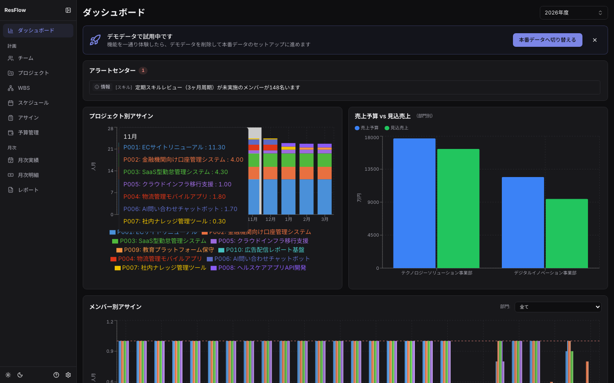
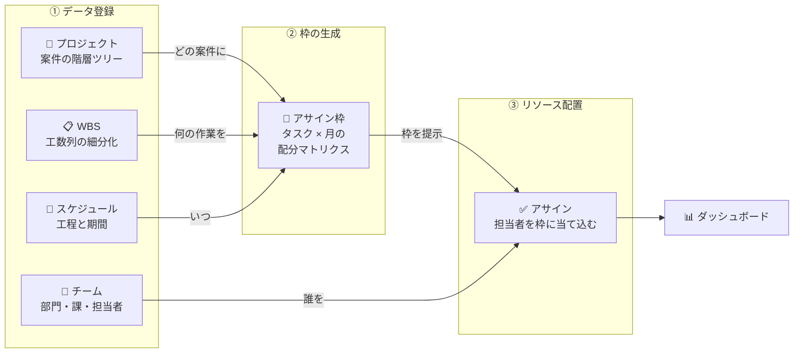

# triplan

[](https://github.com/froggugugugu/triplan/actions/workflows/ci.yml)
[](https://github.com/froggugugugu/triplan/actions/workflows/e2e.yml)
[](https://github.com/froggugugugu/triplan/actions/workflows/security-audit.yml)
[](https://github.com/froggugugugu/triplan/actions/workflows/codeql.yml)
[](LICENSE)


> **English summary** — triplan is a resource-allocation and decision-support tool for software projects, built around the practices of the Japanese SI industry. It manages every project on three axes at once: **people** (team and monthly allocation), **things** (WBS, schedule, progress) and **money** (budget, EVM, orders and invoicing). It ships with a browser-only mode (localStorage) and a self-hosted mode (Fastify + PostgreSQL). The UI and documentation are in Japanese by design.

日本のシステム開発の商習慣に合わせて、案件を**人（体制）・モノ（機能・スケジュール）・金（予算）**の3軸で一体管理するWebアプリケーション。年度単位（4月〜翌年3月）の月次リソース配分を起点に、予算・EVM・商流（受注・請求・変更管理）・月次実績の確定と締め・外部タスク管理ツールとの完了同期までをカバーします。



## Demo

https://resource-planner-five.vercel.app （localモード。ブラウザ内にだけデータが保存されます）

## プロジェクトの位置づけ

個人プロジェクトとして開発しています。ソースコード・ドキュメント・デモは自由に利用できます。IssueとPull Requestは歓迎しますが、対応の速さは保証していません。進め方は [CONTRIBUTING.md](CONTRIBUTING.md) を、脆弱性の報告は [SECURITY.md](SECURITY.md) を参照してください。

## コンセプト

本ツールは「**枠を作ってから、リソースを当て込む**」という考え方で設計されています。



タスクの日次実行管理はBacklog・Asana・Jira等の専門ツールに委ね（「餅は餅屋」）、本ツールはCSV/Webhookの疎結合連携で完了状態を受け取り、経営判断のための予実（EVM・損益・稼働）へ接続します。

## 主な機能

- **プロジェクト管理** — 最大6階層のWBSツリー、コード自動採番、IPA準拠のWBS/ドキュメントテンプレート
- **リソース配分** — タスク×担当者×月のアサイン（計画0.0〜1.0人月）、稼働率上限・契約範囲の検証
- **予算管理** — 部門予算・案件概算（工数×単価×係数）・AI利用費・SaaS費用・人員計画の予実
- **入力させないEVM** — PV=計画の凍結、EV=WBS完了（外部ツールから自動同期可）、AC=アサイン表＋月次実績。3指標とも手入力ゼロで自動導出
- **商流管理** — 受注額・請求マイルストン（検収→請求→入金）・変更管理（CR承認で受注額/納期を自動反映）
- **月次実績と締め** — 実績の確認・修正・確定（CSV取込対応）、締め済み月のハードロック＋監査イベント
- **外部完了同期** — Backlog/Asana/Jiraとの連携CSV・Webhook受信でWBS完了チェックを自動化
- **権限管理（postgresモード）** — 5ロール＋権限マトリクス、金額情報の多層マスキング
- **レポート** — CSV3帳票（案件別収支・要員別稼働・部門予算予実、Excel対応BOM付き）・月次明細

## ドキュメント

| ドキュメント | 内容 |
| --- | --- |
| [プロジェクト管理の基礎](docs/guide/project-management.md) | 管理をしたことがない方へ。QCD（品質・コスト・納期）と人・モノ・金の関係、管理の基本サイクル、よくある失敗（ツールの操作は出てきません） |
| [triplanの使い所](docs/guide/concept.md) | 何をして何をしないツールか、向いている場面、導入の段取り |
| [利用ガイド](docs/guide/index.md) | 画面ごとの使い方（GitHub Pages対応。リポジトリ設定 → Pages → `main` ブランチ `/docs` を指定すると公開できます） |
| [docs/](docs/) | 開発者向けリファレンス（ルーティング・ストア・スキーマ・開発パターン） |

## クイックスタート（localモード・DB不要）

Node.js 22以上（npm 11以上）だけで動きます。データはブラウザのlocalStorageに保存されます。

```bash
npm install
npm run dev
```

`http://localhost:5173` を開くと、ダッシュボードの「はじめに」カードから**初期設定ウィザード**が起動できます。デモデータで試すか、自分のデータ（基本設定→組織→担当者→プロジェクト）でセットアップするかをGUIで選べます。デモで開始した場合も、あとからウィザードの「本番データへ切り替える」でそのまま本番セットアップへ移行できます。

## Docker + PostgreSQLで立ち上げる（postgresモード）

マルチユーザー・権限管理・Webhook受信を使う構成です。必要なものは **Docker Desktop**（`docker compose` が使えること）と **Node.js 22以上（npm 11以上）** の2つだけです。

### ワンコマンドで起動する

下記の手順1〜5をまとめたスクリプトがあります。各ステップは冪等なので、2回目以降は
済んでいるものを飛ばします。

```bash
npm run dev:postgres
```

`http://localhost:5173` が開ける状態になり、初回は管理者アカウント
（`admin@example.com` / `AdminPass123`）が作成されます。停止は `Ctrl+C`（DBコンテナは
データ保持のため起動したまま残ります）。

```bash
# 管理者の情報やポートを変える
ADMIN_EMAIL=me@example.com ADMIN_PASSWORD=MyPass12345 npm run dev:postgres
API_PORT=3010 CLIENT_PORT=5180 npm run dev:postgres

# 管理者のパスワードが分からなくなったとき（既存アカウントに再設定する）
npm run dev:postgres -- --reset-admin

# DBを作り直してから起動する（データは消えます）
npm run dev:postgres -- --reset-db
```

> **管理者が既に居る場合、パスワードは変更されません。** 2回目以降の起動で
> `admin@example.com / AdminPass123` を表示しないのはこのためです（表示すると
> 「その値で入れる」と誤解させるため）。パスワードが分からなくなったら
> `--reset-admin` を使ってください。

以下は、このスクリプトが何をしているかの内訳です（手動で実行することもできます）。

### 1. PostgreSQLコンテナを起動する

リポジトリのルートで実行します（`docker-compose.yml` 配置済み）。

```bash
docker compose up -d
```

起動確認（`postgres` が `healthy` になるまで数秒待ちます）:

```bash
docker compose ps
```

> データはnamed volumeに永続化されます。`docker compose down` で停止してもデータは残ります（完全に消すのは `docker compose down -v` のときだけ）。

### 2. サーバーの環境変数を用意する

```bash
cp server/env.example server/.env
```

`server/.env` はgit管理外です。開発用途ならそのままで動きます。本番運用時は `JWT_ACCESS_SECRET`・`JWT_REFRESH_PEPPER`・`SSO_ENCRYPTION_KEY` を必ずランダム値に置き換えてください（生成コマンドはファイル内のコメント参照）。

### 3. 依存インストールとDBマイグレーション

```bash
npm --prefix server install
npm --prefix server run db:migrate
```

### 4. 管理者ユーザーを作成する

```bash
npm --prefix server run db:seed-admin -- --email=admin@example.com --name=管理者 --password=<8文字以上>
```

ここで指定したメールアドレス・パスワードがログイン情報になります。

### 5. サーバーとクライアントを起動する

ターミナルを2つ使います。

```bash
# ターミナル1: APIサーバー（http://localhost:3001）
npm --prefix server run dev

# ターミナル2: クライアント（postgresモード指定）
VITE_STORAGE_MODE=postgres npm run dev
```

`http://localhost:5173` を開くとログイン画面が表示されるので、手順4のアカウントでログインします。

### 6. 停止する

```bash
# 各ターミナルで Ctrl+C
docker compose down   # DBコンテナ停止（データは保持）
```

うまくいかないときの確認ポイントや、Drizzle Studio（DBブラウザ）・localStorageからの移行CLI・Webhook受信の設定は [`server/README.md`](server/README.md) を参照してください。

### 本番運用（セルフホスト）

上記はNode.jsを使う開発者向けの構成です。チームで常用する本番構成（Dockerのみで完結、
web＋API＋DBの3コンテナ、バックアップ・更新手順つき）は
[本番セルフホスト手順](docs/guide/self-host.md) を参照してください。

```bash
cp deploy/env.example deploy/prod.env   # シークレットを必ず変更する
docker compose --env-file deploy/prod.env -f docker-compose.prod.yml up -d --build
```

## テスト・品質チェック

| コマンド | 説明 |
| --- | --- |
| `npm run dev` | 開発サーバー起動（HMR） |
| `npm run build` | 型チェック + 本番ビルド |
| `npm run check` | Biome Check（Lint + Format） |
| `npm run test:run` | ユニットテスト一回実行 |
| `npm run test:coverage` | カバレッジ付きテスト |
| `npm run e2e` | Playwright E2E（ポート競合時は `E2E_PORT=5273 npm run e2e`） |
| `npm run depcruise` | レイヤー依存方向チェック |
| `npm --prefix server run test:run` | サーバーテスト（Testcontainers使用、Docker必須） |

## セキュリティ（サプライチェーン対策）

- **バージョン固定**: 直接依存はすべて完全一致バージョンで `package.json` に記録しています（`.npmrc` の `save-exact=true` で以後の追加も固定）。インストールは `npm ci` を推奨（lockfileと完全一致しない場合に失敗し、すり替えを検知できます）
- **CVE監視**: GitHub Actions（[security-audit](.github/workflows/security-audit.yml)）がPR/push時と週次で `npm audit --audit-level=high` を実行し、high以上の脆弱性をゲートします
- **更新経路の一本化**: 依存更新は [Dependabot](.github/dependabot.yml) のPR（週次・パッチ/マイナーはグループ化）経由でのみ行い、CIのテスト・auditを通してから取り込みます
- **既知の受容済みリスク**: `server` 側の `drizzle-kit` が内包する esbuild の moderate 4件は、開発時のCLI実行のみで使われ本番ランタイムに含まれず、攻撃条件（devサーバーへのブラウザアクセス）も成立しないため受容しています（強制修正はdrizzle-kitの破壊的ダウングレードを要するため見送り）
- アプリ側の方針: localStorageに機密情報を保存しない／ユーザー入力はZodで検証／金額情報はサーバー側マスキング（多層防御）

## ディレクトリ構成

```text
src/                    # クライアント（React + Vite）
├── features/           # 機能別モジュール（Feature-Sliced Design）
│   ├── projects/       # プロジェクト・WBS・EVM・商流・完了同期
│   ├── assignment/     # アサイン（タスク×担当者の月次配分）
│   ├── actuals/        # 月次実績・CSV取込・締め
│   ├── budget/         # 予算管理（部門・AI利用費・SaaS・人員計画）
│   ├── statements/     # 月次明細（協力会社支払・発注元向け）
│   ├── team/           # チーム（組織階層・スキル）
│   ├── dashboard/      # ダッシュボード・アラートセンター
│   └── reports/        # CSVレポート・データ管理
├── shared/             # 共通コンポーネント・型（Zod）・ユーティリティ
├── infrastructure/     # DataAdapter（localStorage / PostgreSQL API）
└── stores/             # Zustand ストア

server/                 # APIサーバー（Fastify + Drizzle、postgresモード用）
docs/                   # 開発者向けドキュメント + 利用ガイド（docs/guide/）
e2e/                    # Playwright E2E
```

## リリースと配布

- バージョンとCHANGELOGは [release-please](https://github.com/googleapis/release-please) がConventional Commitsから自動生成します（[CHANGELOG.md](CHANGELOG.md)）
- リリースのたびに本番用のDockerイメージを GitHub Container Registry へ公開します
  - `ghcr.io/froggugugugu/triplan-web`（nginx＋クライアント）
  - `ghcr.io/froggugugugu/triplan-server`（APIサーバー）
- セルフホストの手順は [docs/guide/self-host.md](docs/guide/self-host.md) を参照してください

## コントリビュート

バグ報告・機能要望は [Issue](https://github.com/froggugugugu/triplan/issues/new/choose)、相談は [Discussions](https://github.com/froggugugugu/triplan/discussions) へ。変更を送る前に [CONTRIBUTING.md](CONTRIBUTING.md)（開発環境・品質ゲート・コミット規約）と [CODE_OF_CONDUCT.md](CODE_OF_CONDUCT.md) を確認してください。

## ライセンス

[MIT License](LICENSE)
