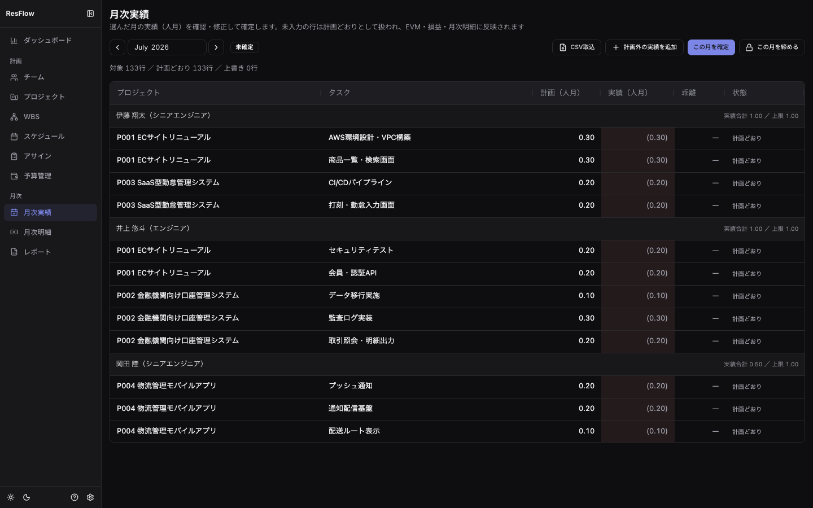

## 概要

「入力させない」原則の中核画面です。**未入力の行は計画どおりとして扱われる**ため、
計画と同じだった月は何もする必要がありません。ズレた分だけ直します。

## 実績の確認・修正

- 対象月（既定は前月）の全アサインが担当者ごとに一覧されます
- 実績セルの `(0.50)` のような**薄い括弧表示は「計画どおり」**（データ未書込み）。
  数値を入力すると上書き（実績値）になります
- **実績は事実の記録**なので1.0人月超（残業等）も入力できます。上限超過は警告表示のみ
- 「計画どおりに戻す」（↩ボタン）で明示入力をクリアできます
- 計画に無い稼働は「計画外の実績を追加」から記録します

## CSV取込

外部ツール（工数収集ツール等）のエクスポートを取り込めます。

1. 「CSV取込」→ファイル選択（ヘッダ行必須・Excel出力のBOM付きも可）
2. 列マッピング（自動推定・手動修正可）と単位（人月/人日/時間）を指定
3. **突合プレビュー（ドライラン）**で適用予定・スキップ理由を確認してから適用

- 日次の行は月へ自動合算されます。メンバーはemail（推奨）または氏名で、プロジェクトは
  コード（推奨）または名称で突合します。**曖昧な行（同名複数など）は取り込まれず理由が残ります**
- 列の割り当ては「**取込プロファイル**」として保存できます（役割→列名で保存されるため、
  列の並びがファイルごとに変わっても適用できます。単位もプロファイルに含まれます）
- 取込履歴（直近5件）が画面下部に残ります

## 確定（ソフトロック）

「この月を確定」は**チェックが済んだ印**です。データは書き込まれず、確定後の編集も
警告つきで可能です。確定した月の実績は、EVMのAC・案件別損益・月次明細が同じ値を読みます。

## 締め（ハードロック）

- 管理職（postgresモードでは`governance:approve`権限）だけが「この月を締める」を実行できます
- 締め済み月は**実績も計画も変更不可**になります（アサイン画面・CSV取込を含む）。
  締め月に値を持つアサインを道連れにするプロジェクト/タスクの削除もブロックされます
- 修正が必要になったら「締めを解除」します。**解除には理由の入力が必須**で、
  締め・解除の履歴は削除できない監査記録として画面下部に残ります
- postgresモードでは締め・解除の実行者名がサーバー側で記録され、チャット通知
  （設定時）にも送出されます
