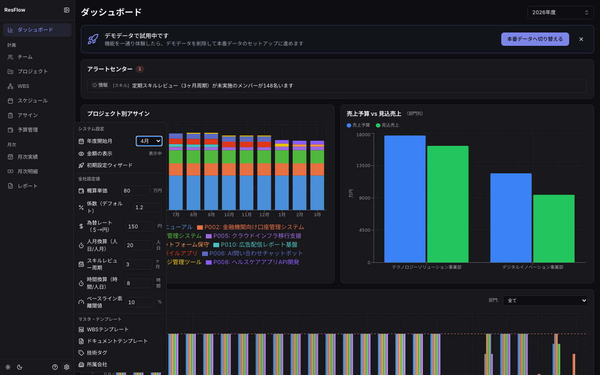
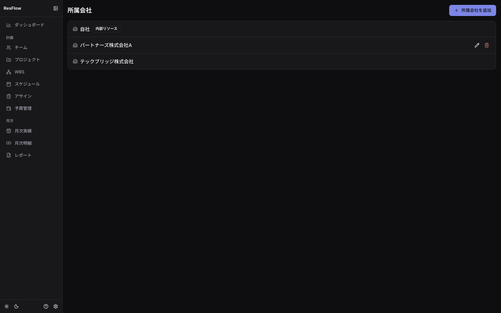

## 動作モード

| モード | 用途 | 認証 |
| --- | --- | --- |
| local（既定） | 個人利用・お試し。ブラウザのlocalStorageに保存 | なし（単一ユーザー） |
| postgres | チーム利用。PostgreSQL＋APIサーバー | ID/パスワード（JWT） |

## ロールと権限（postgresモード）

5ロールの線形階層で、上位は下位の権限をすべて含みます。

| 権限 | admin | manager | editor | viewer | partner |
| --- | :-: | :-: | :-: | :-: | :-: |
| ユーザー管理 | ✓ | - | - | - | - |
| 全社設定の変更 | ✓ | ✓ | - | - | - |
| 承認・凍結・月次締め | ✓ | ✓ | - | - | - |
| 業務データの編集 | ✓ | ✓ | ✓ | - | - |
| 金額情報の閲覧 | ✓ | ✓ | ✓ | ✓ | - |
| 業務データの閲覧 | ✓ | ✓ | ✓ | ✓ | ✓ |

- **partner**は協力会社等の外部関係者向け: 閲覧のみで、単価・予算・受注額などの
  金額情報は画面からもAPIレスポンスからも遮断されます（多層防御）
- ユーザーの追加・ロール変更は adminが「ユーザー管理」画面（システム設定メニュー）から行います

## 金額の表示制御（localモード）

認証の無いlocalモードでは、システム設定の「金額の表示」トグルで金額情報の表示/非表示を
切り替えられます（画面共有・協力会社同席時の利便機能）。

## システム設定（歯車アイコン）

サイドバー下部の歯車アイコンからポップオーバーを開きます。「全社設定値」
「マスタ・テンプレート」「管理者」のセクションに分かれています。

### 全社設定値（業務定数）

| 設定 | 既定値 | 影響 |
| --- | --- | --- |
| 概算単価（万円） | — | 案件概算予算・人員計画・EVMのBAC |
| 係数デフォルト | — | 案件概算予算（案件別の係数はプロジェクトタブで上書き） |
| 為替レート（円/＄） | — | AI利用費の万円換算（適用開始月つき履歴） |
| 人月換算（人日/人月） | 20 | 概算予算・CSV取込の単位換算・準委任精算の時間換算 |
| 時間換算（時間/人日） | 8 | CSV取込の時間→人月換算・準委任精算の時間換算 |
| スキルレビュー周期（月） | 3 | レビュー未実施アラート |
| ベースライン乖離閾値 | ±10% | 再凍結を促す警告 |

設定の変更はpostgresモードでは`settings:manage`権限（admin/manager）が必要です。

### マスタ・テンプレート

- **WBSテンプレート／ドキュメントテンプレート**: [計画を立てる](planning.md)参照
- **技術タグ**: カテゴリ／サブカテゴリ・199タグのプリセット管理
- **所属会社**: 協力会社等のマスタ。内部リソース（自社）フラグ・インボイス登録番号・
  支払サイト（締め日・支払月オフセット・支払日）を登録します

### 管理者（postgresモードのみ）

- **ユーザー管理**: ユーザーの追加・ロール変更・有効/無効化（admin限定）
- **通知設定**: チャットツール通知チャンネルの管理・テスト送信・送信ログ
  （[外部ツール連携](integration.md)参照）
- **APIキー**: 公開API v1のキー発行・無効化（[外部ツール連携](integration.md)参照）

## バックアップ

- localモード: レポート画面のJSONエクスポートを定期的に保存してください
- postgresモード: PostgreSQLの標準バックアップ（pg_dump等）に加え、
  管理者はAPIのdatabase export/importでJSON形式の移行・退避ができます
