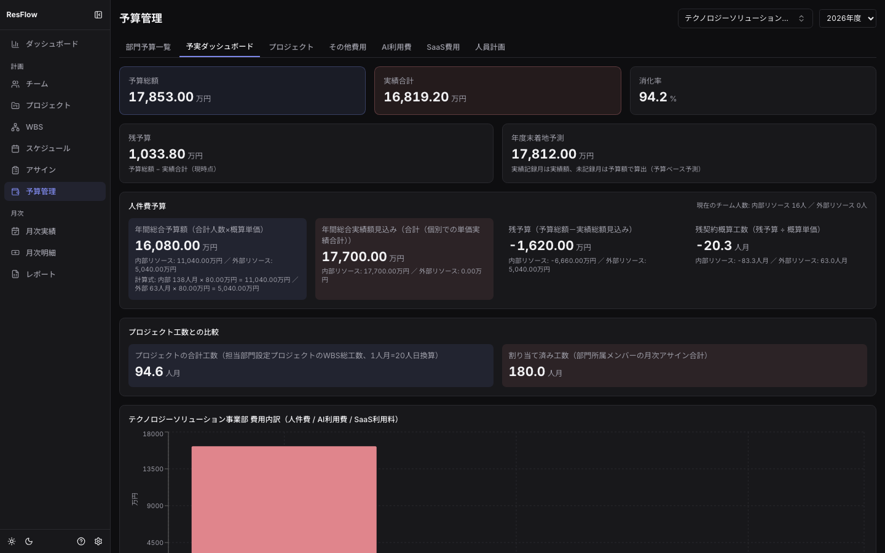
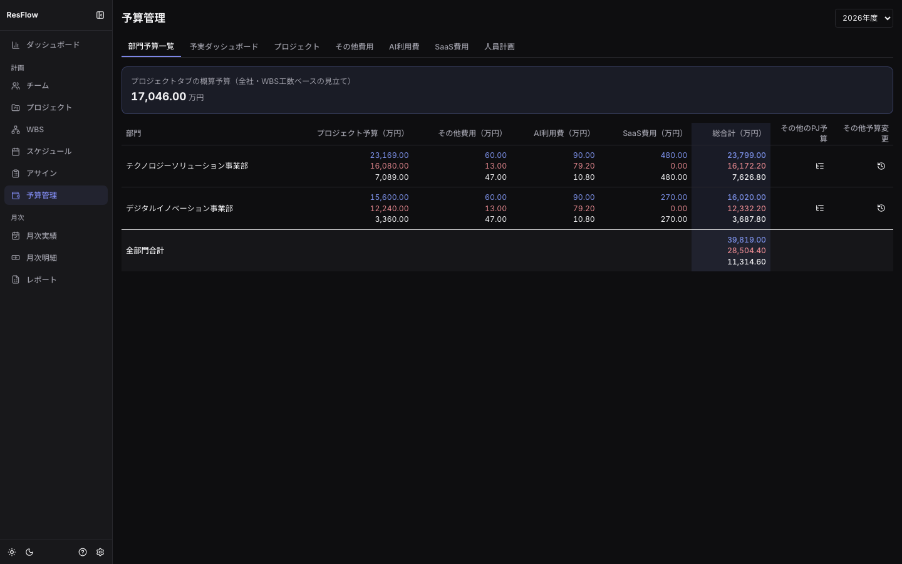
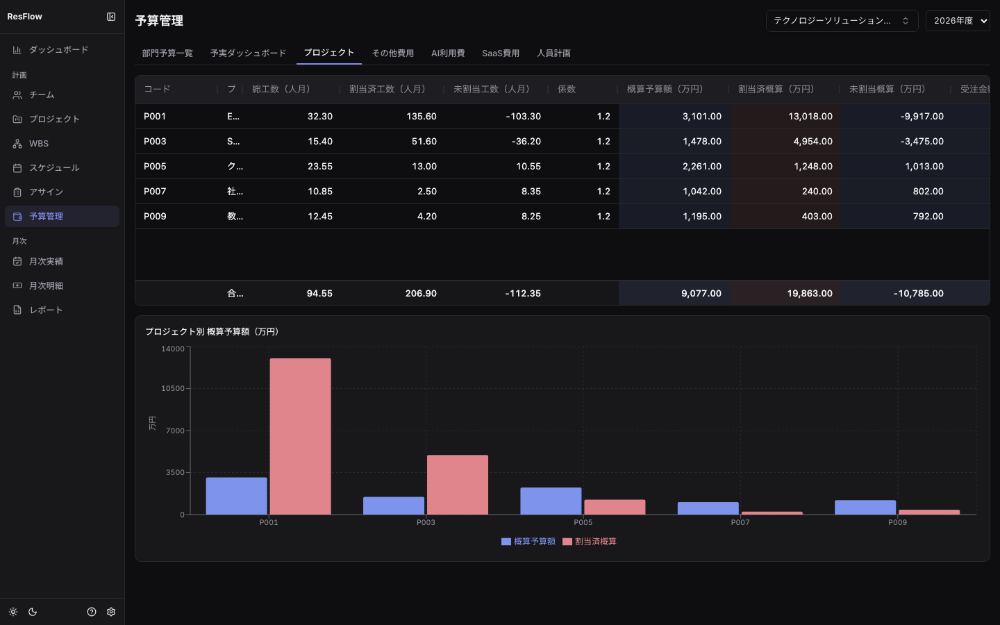
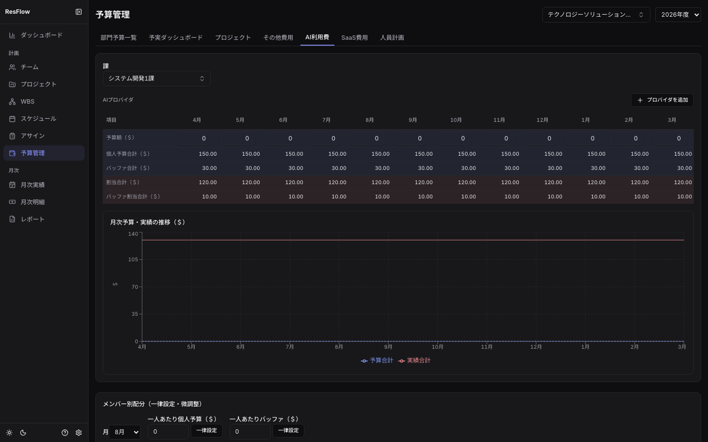
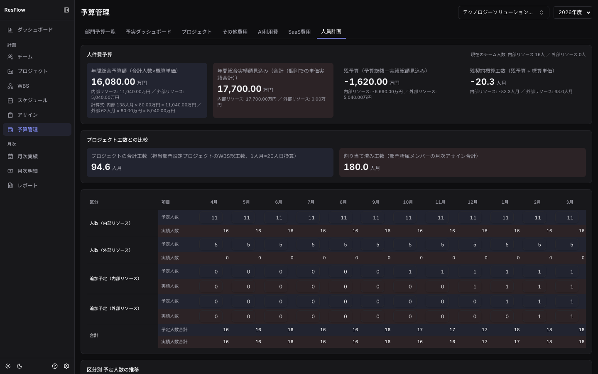

## 予算管理（/budget）※金額権限が必要

7タブ構成。部門セレクタで対象部門を切り替えます（「全部門」で横断集計）。
タブ順は「部門予算一覧／予実ダッシュボード／プロジェクト／その他費用／AI利用費／SaaS費用／
人員計画」で、初期表示は**予実ダッシュボード**です。

| タブ | 内容 |
| --- | --- |
| 部門予算一覧 | 案件予算/その他費用/AI利用費/SaaS費用の予実俯瞰（5列×3行） |
| 予実ダッシュボード | 年度末着地予測・月次推移 |
| プロジェクト | WBS工数ベースの概算予算（工数×概算単価×係数）・受注金額との損益・**原価4区分** |
| その他費用 | 一般経費の予算枠と実績明細（購入日・品目・金額） |
| AI利用費 | プロバイダ別・課別の予算実績（＄建て・為替換算）とメンバー配分 |
| SaaS費用 | 契約一覧・年間コスト・更新期限警告 |
| 人員計画 | 内部/外部リソース×月別の予定・実績人数 |

概算単価・係数・為替レートはシステム設定（歯車アイコン）から変更します。

### プロジェクトタブと原価4区分

- 概算予算額 = 総工数（人月）× 概算単価 × 係数。係数は行ごとに上書きできます
- 受注金額が設定された案件は粗利・利益率が表示され、実コストの内訳が**原価4区分**
  （労務費＝内部リソース／外注費＝外部リソース／直接経費＝案件紐づき実績明細／
  間接費配賦＝部門の間接費を直接工数比例で配賦）と**配賦後利益**（粗利−間接費配賦）で見えます

### AI利用費・人員計画

- AI利用費は＄建てで入力し、システム設定の為替レート（適用開始月つき履歴）で万円換算されて
  部門予算・予実ダッシュボードへ合算されます
- メンバー別配分（個人予算/バッファ/割当/バッファ割当）は課・プロバイダで絞り込んで一律設定できます

## 入力させないEVM

EVMのためだけの入力作業はありません。3指標は普段の作業から自動導出されます:

| 指標 | 出どころ | あなたがすること |
| --- | --- | --- |
| PV（計画値） | 凍結したアサイン計画の形×BAC | 計画確定時にWBS画面で「計画を凍結」（CR承認時は再凍結） |
| EV（出来高） | WBS完了チェックの工数加重 | 完了チェック（または外部ツール同期で自動） |
| AC（実コスト） | アサイン表×単価（実績確定値を優先） | なし（月次実績の確定だけ） |

- チャートはダッシュボードと各案件のEVMダイアログで確認できます。受注額・予算枠は
  参照線として重なります
- 現行計画が凍結時から±10%乖離すると再凍結を促す警告が出ます
- 外部システムからは公開API `GET /api/v1/projects/{id}/evm` で同一の週次系列を取得できます
  （[外部ツール連携](integration.md)参照）

## プロジェクトサマリー（/project-summary）

**PMが週次に「この案件は大丈夫か」を1分で確認する**ための統合ビューです。プロジェクトを
選ぶと、総合判定バッジ（🟢良好／🟡要注意／🔴危険／⚪判定不能）と判定理由、
金（損益・原価4区分）／モノ（進捗・EVM・現工程）／人（体制・山積み）／商流（売上計上・
受注残・変更要求）が1画面に集約されます。

- 判定はAIではなく**決定論的な8ルール**（納期超過・遅延予測・予算超過・予算先行・SPI低下・
  ベースライン乖離・配分ギャップ・稼働超過）。判定材料が無い項目は黙ってスキップされます
- 「予算先行の警告閾値（既定15pt）」「SPI警告閾値（既定0.90）」はシステム設定で変更できます
- 金額情報が非表示のユーザー（partner・表示トグルOFF）でも、進捗・体制・納期の確認には
  そのまま使えます（金・商流セクションだけが隠れます）
- 複数案件の横並び比較はダッシュボード、1案件の深掘りはこの画面、という役割分担です

## ダッシュボードとアラートセンター（/dashboard）

最上部の**アラートセンター**に、納期超過・遅延予測・予算超過・稼働超過・ベースライン乖離・
SaaS更新期限・スキルレビュー未実施が重大度順に集約されます。「まず開く画面」として使ってください。
