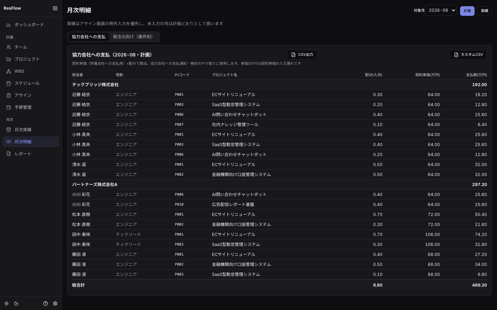
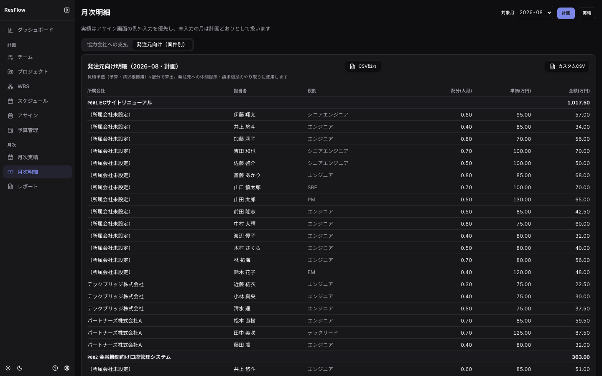
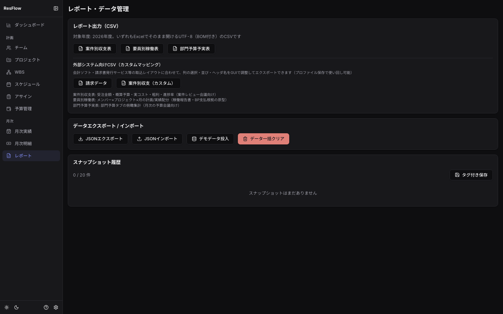

## 商流管理（プロジェクト画面の「商流」列）

トップレベル案件のレシートアイコンから開きます。

- **請求マイルストン**: 受注額を検収時期に分割割付し、予定→検収済→請求済→入金済を追跡します。
  売上計上額（検収基準）・受注残が自動集計され、配分合計と受注額の不一致は警告されます
- **変更管理（CR）**: 期中の契約変更（受注額差分・工数差分・新納期）を申請→承認/却下。
  **承認すると受注額・納期がプロジェクトへ自動反映**され、「なぜ着地が動いたか」が履歴に残ります。
  承認/却下済みのCRは削除できません（追跡性の保持）。postgresモードでは承認/却下が
  チャット通知（設定時）にも送出されます

## 月次明細（/statements）※金額権限が必要

単価の二重管理を2方向の帳票に写します。対象月と計画/実績を切り替えてCSV出力できます。

- **協力会社への支払**タブ: 会社→人→案件の階層で**契約単価**×配分を集計
  （契約単価が未入力の行は0のまま警告色＝入力漏れの検知）。
  会社マスタのインボイス登録番号・支払サイト（支払期日）も表示されます
- **発注元向け**タブ: 案件→会社→人の階層で**見積単価**×配分を集計

### 準委任の月次精算（実績モード・協力会社タブ）

契約単価履歴に精算幅（下限h/上限h）を設定したメンバーは、実績モードで「精算」列に
幅内／控除／超過の判定と精算額が自動表示されます。

- 実績時間 = 実績人月 × 人月換算（人日/人月）× 時間換算（時間/人日）で算出
- 幅内（境界含む）=固定額／下回り=基準額÷下限×実績h／超過=基準額＋基準額÷上限×超過h
- 明細行へは実績比で按分され、丸め差は最終行で調整されます（Σ行金額=精算額）

### カスタムCSV

両タブの「カスタムCSV」から、列の選択・並び替え・ヘッダ名の改名をGUIで編集し、
外部システム（会計ソフト・請求書発行サービス）が読める形でエクスポートできます。
設定は**マッピングプロファイル**として保存・再利用できます。

> 請求書PDFは作りません（餅は餅屋）。請求書発行サービスへはカスタムCSVで渡します。

## レポート（/reports）

- **CSV帳票**: 案件別収支表（原価4区分を含む）・要員別稼働表・部門予算予実表
  （UTF-8 BOM付き、Excelでそのまま開けます）
- **外部システム向けカスタムCSV**: 請求データ・案件別収支のマッピングエクスポート
- **スナップショット**: 任意時点のデータをタグ付きで保存・復元（最大20件）
- **エクスポート/インポート**: 全データのJSONバックアップ。localモード⇄postgresモードの
  移行にも使います

## What-ifシミュレーション

プロジェクト画面のWhat-ifアイコンから、「どのタスクを削れば予算に収まるか」を試算できます。
チェックしたタスク（とその配下）を除外した概算予算と削減額が即時表示されます。
実データは一切変更されない読み取り専用の試算です。
