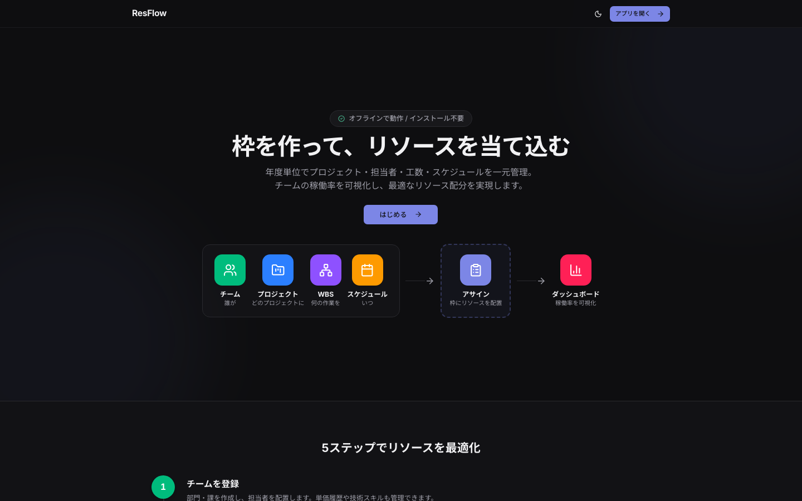
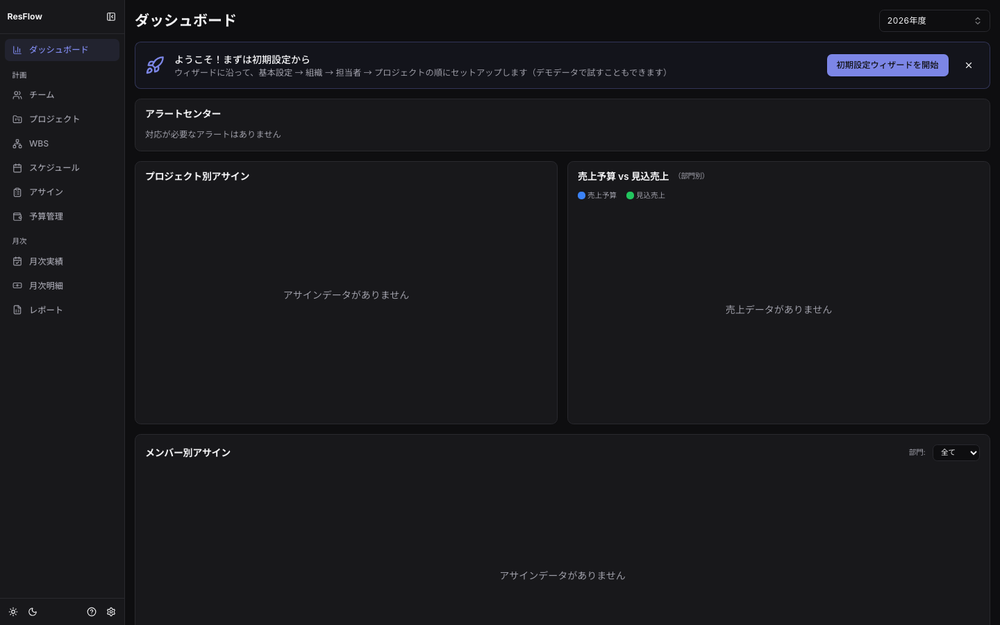
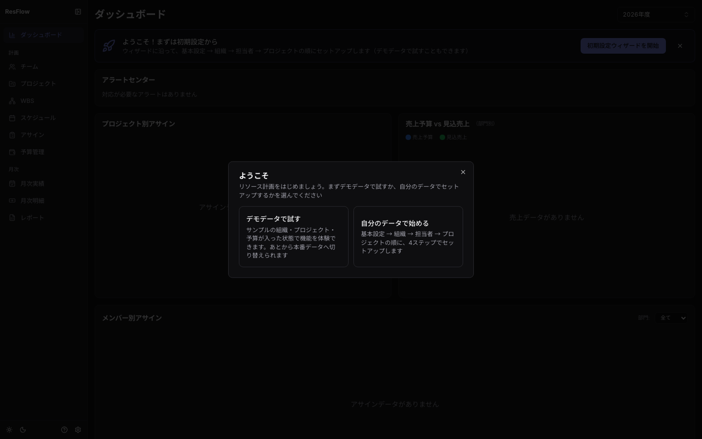

> プロジェクト管理そのものが初めてなら、先に
> **[プロジェクト管理の基礎](project-management.md)** と
> **[triplanの使い所](concept.md)** を読むと、各画面が何のためにあるのか掴めます。

## 起動する

- **お試し・個人利用（localモード）**: `npm install && npm run dev` だけで動きます。
  データはブラウザのlocalStorageに保存されます（サーバー・DB不要）
- **チーム利用（postgresモード）**: Docker + PostgreSQLで動かします。
  手順はリポジトリの [README](../../README.md#docker--postgresqlで立ち上げるpostgresモード) を参照

トップページ（`/`）はランディングページです。「アプリを開く」からダッシュボードへ入ります。

## 初期設定ウィザード

業務データが空の状態でダッシュボードを開くと、最上部に「はじめに」カードが表示されます。

「**初期設定ウィザードを開始**」を押すと、基本設定（年度開始月・概算単価・人月換算）→
組織（部門・課）→ 担当者 → 最初のプロジェクト（コード自動採番＋標準WBSテンプレート適用）の
順に、迷わずセットアップできます。各ステップは「次へ」で即保存され、スキップ・中断再開も可能です。

> カードを閉じても、システム設定ポップオーバー（サイドバー下の歯車アイコン）の
> 「初期設定ウィザード」からいつでも再開できます。

## まず試す: デモデータ

ウィザードのようこそ画面で「**デモデータで試す**」を選ぶと、部門・メンバー・案件・予算・
実績の一式が入ります。各画面の見え方を最初に把握するのに便利です。

- デモ投入ボタンは**業務データが空のときだけ**表示されます（実データの誤爆上書き防止）
- デモ試用中はカードが「デモデータで試用中です」表示に変わります。
  「本番データへ切り替える」を押すと、JSONエクスポートでの退避案内つきの二段階確認を経て
  全削除→本番セットアップへ進めます

## 画面の全体像

サイドバーは業務の時系列でグループ化されています。

| グループ | メニュー | 役割 |
| --- | --- | --- |
| — | ダッシュボード | 稼働率・予実・EVM・**アラートセンター**（納期・予算・稼働の警告を集約） |
| 計画 | チーム | 部門・課・担当者・単価・スキルの管理 |
| 計画 | プロジェクト | 案件ツリー・受注情報・商流（請求/変更管理）・What-if試算 |
| 計画 | プロジェクトサマリー | 1案件の健全性を1分で確認（判定バッジ・金/モノ/人/商流の集約） |
| 計画 | WBS | 工数の細分化・完了チェック・計画の凍結（EVM）・外部連携CSV |
| 計画 | スケジュール | 工程のガントチャート・依存関係 |
| 計画 | アサイン | タスク×担当者×月の配分（計画/実績トグル） |
| 計画 | 予算管理 | 部門予算・案件概算・AI利用費・SaaS・人員計画（金額権限が必要） |
| 月次 | 月次実績 | 単月フォーカスの実績確認・確定・締め・CSV取込 |
| 月次 | 月次明細 | 協力会社への支払明細・発注元向け明細（金額権限が必要） |
| 月次 | レポート | CSV帳票・スナップショット・データのエクスポート/インポート |

マスタ・テンプレート類（WBSテンプレート／ドキュメントテンプレート／技術タグ／所属会社）と
管理者機能（ユーザー管理・通知設定・APIキー）は、システム設定ポップオーバー（歯車アイコン）から
開きます（[権限とシステム設定](admin.md)参照）。

## 最初のセットアップ（実データ・手動の場合）

ウィザードを使わない場合も、次の順で登録すると迷いません。

1. **チーム**: 部門→課→担当者を登録（単価は任意。予算・EVMを使うなら設定）
2. **プロジェクト**: トップレベル案件を作成（担当部門・受注金額・納期は後からでも可）
3. **WBS**: 「テンプレートを適用」でIPA準拠の標準WBS（要求整理〜リリース判定）を展開すると早い
4. **スケジュール**: 工程の期間を設定（EVMのPVフォールバック・アサイン画面の月範囲に使用）
5. **アサイン**: タスク×担当者に月次配分（1人あたり合計1.0人月/月が上限）
