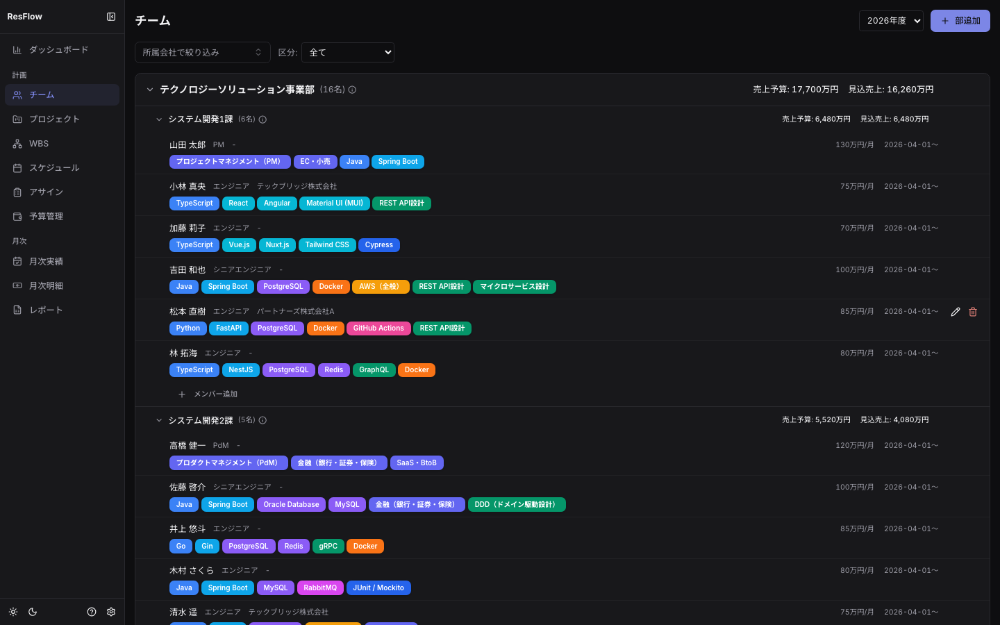
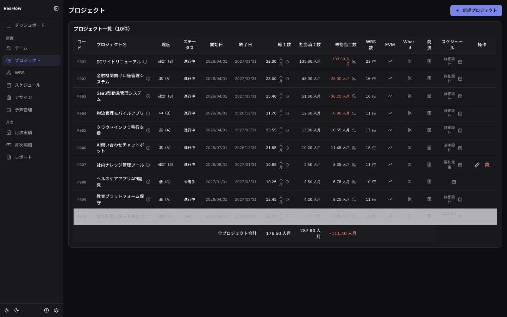
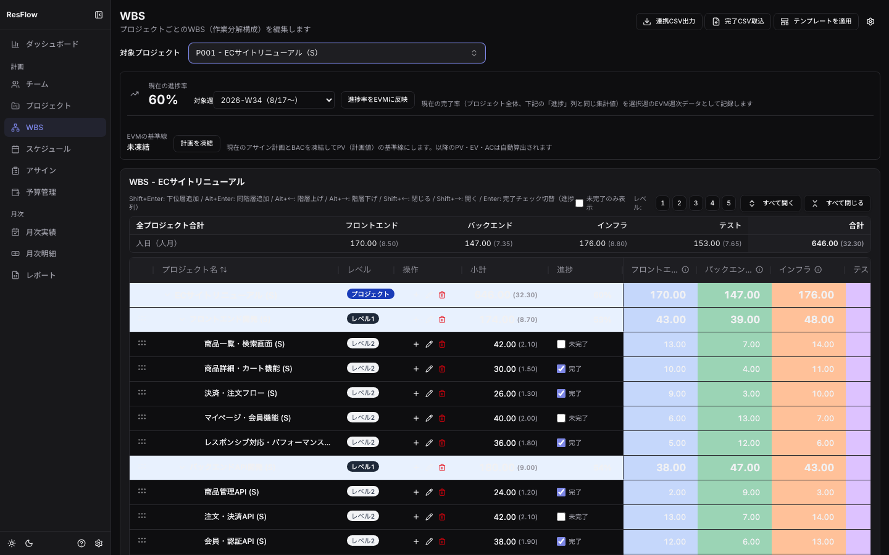
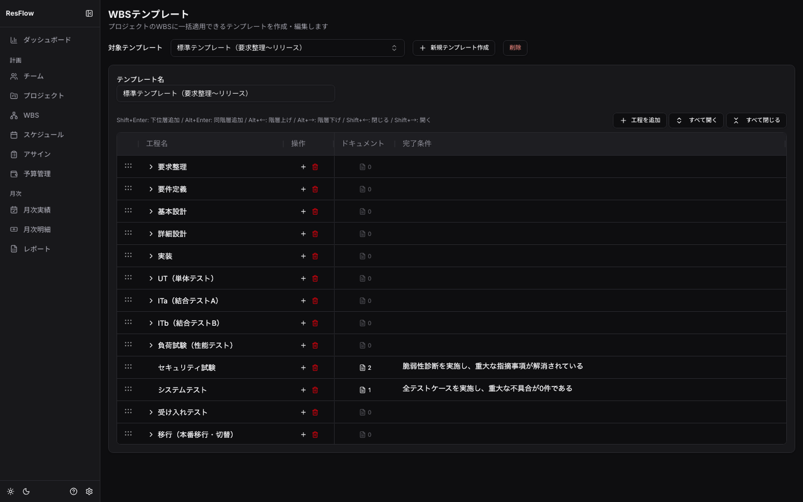
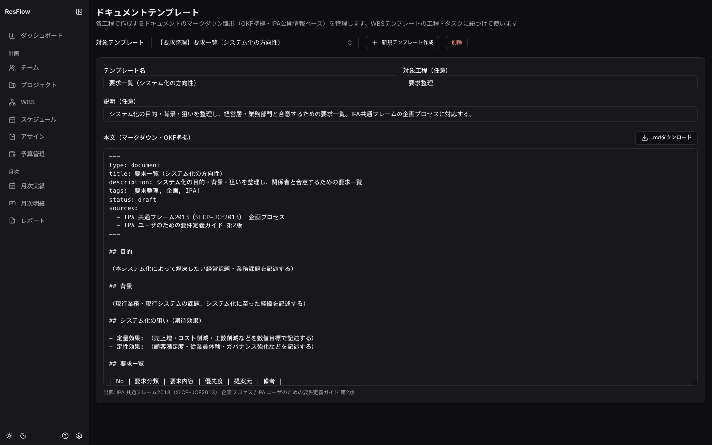
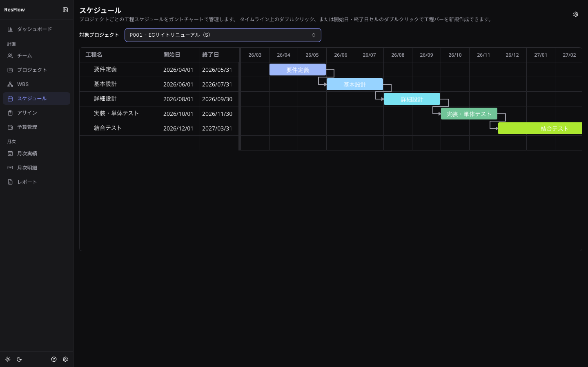
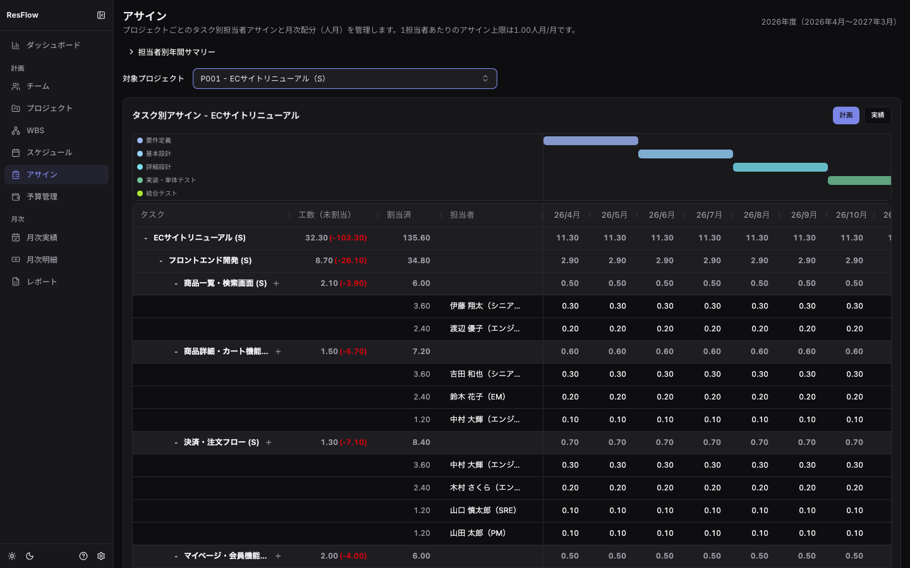
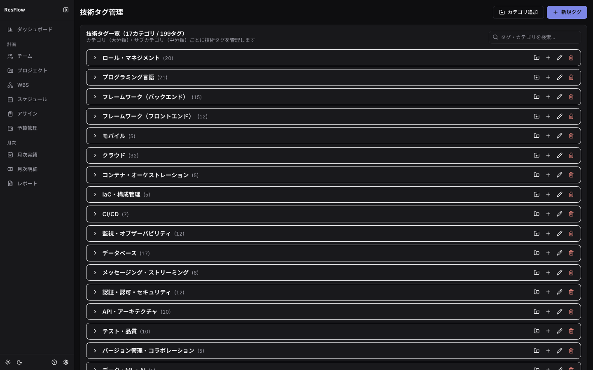

## チーム（/team）

- 部門・課の階層と担当者を管理します。担当者には役割・技術タグ・稼働率上限
  （時短・兼務なら1.0未満）・在籍期間・契約形態（請負/準委任/派遣/正社員）を設定できます
- **単価は2種類**あります: 「単価」=見積・予算確保用／「契約単価」=協力会社への実支払い用。
  両方とも適用開始月つきの履歴で管理します
- 準委任の**精算幅**（例: 140h〜180h）は契約単価履歴の下限h/上限h欄に入力します。
  設定すると月次明細の実績モードで幅内/控除/超過の精算が自動計算されます
  （[商流とレポート](commerce.md)参照）
- スキル: 担当者編集の「スキル・成長記録」タブで、本人/上長評価の履歴と成長ロードマップを記録します
- 所属会社のマスタ（システム設定 → 所属会社）では、内部リソース（自社）フラグに加えて
  **インボイス登録番号**（T+13桁）と**支払サイト**（締め日・支払月オフセット・支払日）を
  登録でき、支払明細に反映されます

## プロジェクトとWBS（/projects・/wbs）

- 案件は最大6階層のツリー。コード（P001-01…）は自動採番で、外部連携の突合キーになるため
  **重複するコードへは変更できません**
- トップレベル案件には担当部門・発注元・受注金額・契約形態・マスター納期・優先度を設定できます
  （納期はアラートセンターの納期超過・遅延予測の起点）
- WBS画面で工数（人日）を列別に入力すると、概算予算（工数×概算単価×係数）とEVMのBACに使われます
- **完了チェック**は最下層タスクのみ。親の進捗率は自動でロールアップされます
- 「テンプレートを適用」でIPA準拠の標準WBSを一括展開。各タスクにはドキュメントテンプレート
  （要件定義書等の雛形）が紐づいています

キーボード操作（WBSグリッド）: Shift+Enter=下位層追加／Alt+Enter=同階層追加／
Alt+←→=階層上げ下げ／Shift+←→=閉じる・開く／Enter=完了チェック切替（進捗列）。

### テンプレートの管理

- **WBSテンプレート**（システム設定 → WBSテンプレート）: 標準テンプレート（IPA共通フレーム準拠・
  全14工程）を初回シード。WBS画面と同じツリー編集UIで自作テンプレートも作成できます

- **ドキュメントテンプレート**（システム設定 → ドキュメントテンプレート）: IPA公開情報ベースの
  標準テンプレート33件（OKF v0.2準拠マークダウン）を管理し、.mdでダウンロードできます。
  WBSテンプレートの「ドキュメント」列からタスクに紐づけます

## スケジュール（/schedule)

工程（最大15件・案件別にカスタム可）の期間をガントチャートで設定します。
工程間の依存関係（FS/SS/FF/SF）も引けます。

## アサイン（/assignment）

- タスク×担当者×月のマトリクスに配分（人月）を入力します。**計画は0.0〜1.0**で、
  担当者の月合計が稼働率上限を超えると警告が出ます
- 契約単価の対象期間外の月には入力できません（0クリアは常に可能）
- ヘッダの「計画/実績」トグルで実績の例外入力もできます（詳細は[月次実績](actuals.md)参照）
- 締め済みの月は🔒表示になり編集できません

## 技術タグ（/tech-tags）

担当者・WBS工数列に紐づける技術タグをカテゴリ／サブカテゴリで管理します。
初回に17カテゴリ・199タグのマスタが自動投入されます。
